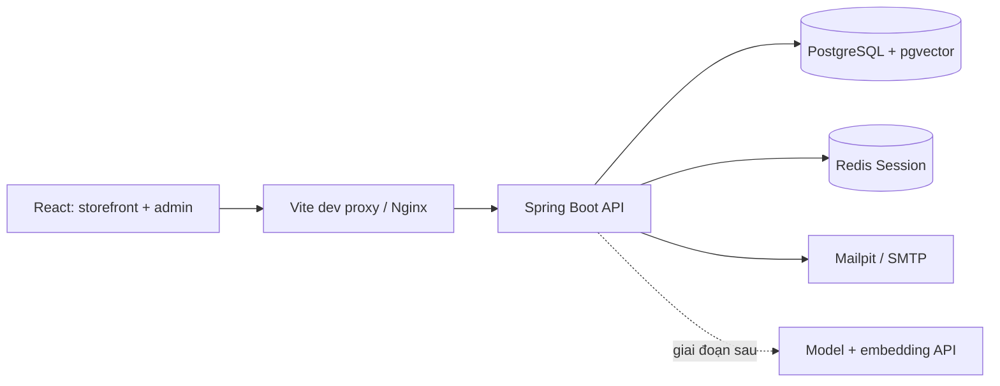

# Kiến trúc

**Cập nhật phân tích 03/11/2026:** chưa thay đổi mã chạy hoặc schema. Tham chiếu [chức năng](REQUIREMENTS.md), [quy tắc](BUSINESS_RULES.md), [mô hình miền](DOMAIN_MODEL.md), [API](API_CONTRACT.md) và [nghiệm thu](ACCEPTANCE.md). D01–D08 là đề xuất cần review, không phải quyết định đã được người dùng phê duyệt.

## Quyết định nền tảng

Dùng một **modular monolith**, một repo và một backend Spring Boot. Chưa cần microservices, Kafka hay Kubernetes cho hai thành viên.

## Backend

Hiện có `config` và `system`. Các package nghiệp vụ thêm dần dưới package gốc:

| Package dự kiến | Trách nhiệm |
|---|---|
| identity | Đăng ký, xác thực Session, vai trò guest/customer/admin |
| catalog | Loại sản phẩm, sản phẩm, tìm kiếm, ràng buộc xóa |
| cart | Giỏ hàng trong HttpSession backed by Redis |
| order | Checkout COD, snapshot giá, đơn hàng, cập nhật số lượng |
| pet | Hồ sơ thú cưng theo tài khoản |
| recommendation | Embedding, truy xuất vector, tư vấn/gợi ý |
| analytics | Sự kiện hành vi và dashboard tổng hợp |
| notification | Email và cơ chế retry |

Mỗi module chứa controller/DTO/service/repository/entity khi cần. Controller mỏng; service chịu trách nhiệm validation nghiệp vụ và transaction; DTO không lộ password/hash.

Spring Security hiện chỉ public GET `/api/v1/info` và `/actuator/health`; mọi route API khác bị từ chối. Chưa có tài khoản admin mặc định, chưa có login. Khi triển khai xác thực: thêm password encoder, Session authentication, CSRF token flow cho React và kiểm tra role ở backend. Không tắt CSRF để giải quyết lỗi tích hợp. Trang `/admin` hiện chỉ là trang giữ chỗ công khai, không phải lớp bảo vệ dữ liệu.

## Redis và Session

Redis hiện được Spring Session dùng để lưu HttpSession, timeout 30 phút. Không có endpoint tạo giỏ hàng ở bộ khung. Tương lai Session chứa giỏ gồm mã sản phẩm/số lượng; không tin giá do client gửi. Giá/tồn kho phải được đọc và kiểm tra lại khi checkout.

Sau đăng nhập cần giữ giỏ guest trong Session và bảo vệ session fixation. Sau checkout thành công chỉ xóa thuộc tính giỏ đúng revision, không hủy phiên đăng nhập hoặc xóa giỏ mới của tab khác. Dùng idempotency key + cart revision ở DB để chống mua lặp. Commit PostgreSQL và cleanup Redis là hai bước, không giả định atomic; quy tắc phục hồi theo BR14.

Redis không phải nơi lưu đơn hàng lâu dài. Cache danh mục và rate limit AI là phần mở rộng; chưa cấu hình. Tránh cache sớm khi chưa có cơ chế invalidation.

## PostgreSQL và vector

Flyway V1 chỉ bật `vector` extension. Chưa tạo schema nghiệp vụ hoặc vector table vì cần chốt mô hình dữ liệu và embedding model/dimension trước. Không bật tự tạo bảng của thư viện AI ngoài luồng migration.

Thiết kế dự kiến gồm user, category, product, order/order_item, pet_profile, behavior_event và bảng embedding. Không tự viết database function/CHECK constraint/stored procedure. PK/FK/UNIQUE vẫn cần, nhất là email unique để chống race condition.

Bản phân tích mới bổ sung order_history, checkout_request, inventory_movement và notification_outbox ở P0. Order/stock/email event commit cùng transaction; gửi SMTP sau commit và retry, không rollback đơn vì mail lỗi. P1 có consent_preference và embedding_job; vector dimension còn chờ lựa chọn model. Xem DOMAIN_MODEL.md để không nhầm với bảng đã tồn tại.

## AI và tracking — dự kiến, chưa triển khai

- Backend gọi API; không đặt khóa trong biến `VITE_*` hoặc frontend.
- Lọc loài/độ tuổi/ngân sách, tìm kiếm ngữ nghĩa kết hợp văn bản, xếp hạng rồi lấy giá/tồn kho hiện hành từ DB.
- Vector lưu nội dung sản phẩm và tài liệu được duyệt; không lưu email, địa chỉ hay khóa bí mật.
- Cập nhật embedding khi nội dung đổi; gắn version model; xử lý xóa/ẩn sản phẩm trước khi trả kết quả.
- Chatbot chỉ đọc dữ liệu được cấp; không có quyền tự mua hàng, sửa giá hoặc gọi SQL tùy ý. Nội dung truy xuất là dữ liệu, không phải chỉ thị.
- Tracking tối thiểu: xem, tìm kiếm, thêm giỏ, checkout, đặt hàng và nhấp gợi ý; event ID chống đếm trùng. Sự kiện đơn thành công phát sinh từ backend.
- Cho phép tắt cá nhân hóa; dữ liệu demo gắn nhãn. Chưa thu thập tracking trong bộ khung.
- Khi model lỗi: tìm kiếm/lọc truyền thống vẫn hoạt động. Có timeout, quota và giới hạn chi phí trước khi bật AI.

## Hạ tầng local

Compose default chỉ khởi động PostgreSQL, Redis, Mailpit. Profile `app` thêm backend và frontend. Health check chờ PostgreSQL/Redis rồi khởi động API; frontend chờ API healthy. Named volumes giữ dữ liệu. Cổng host bind loopback; cấu hình này không phải cấu hình production.

Gợi ý trước khi deploy thật: HTTPS, cookie Secure, credentials riêng, database user tối thiểu quyền, backup/restore, secret management và log không chứa thông tin cá nhân. Không dùng mật khẩu mẫu local.

