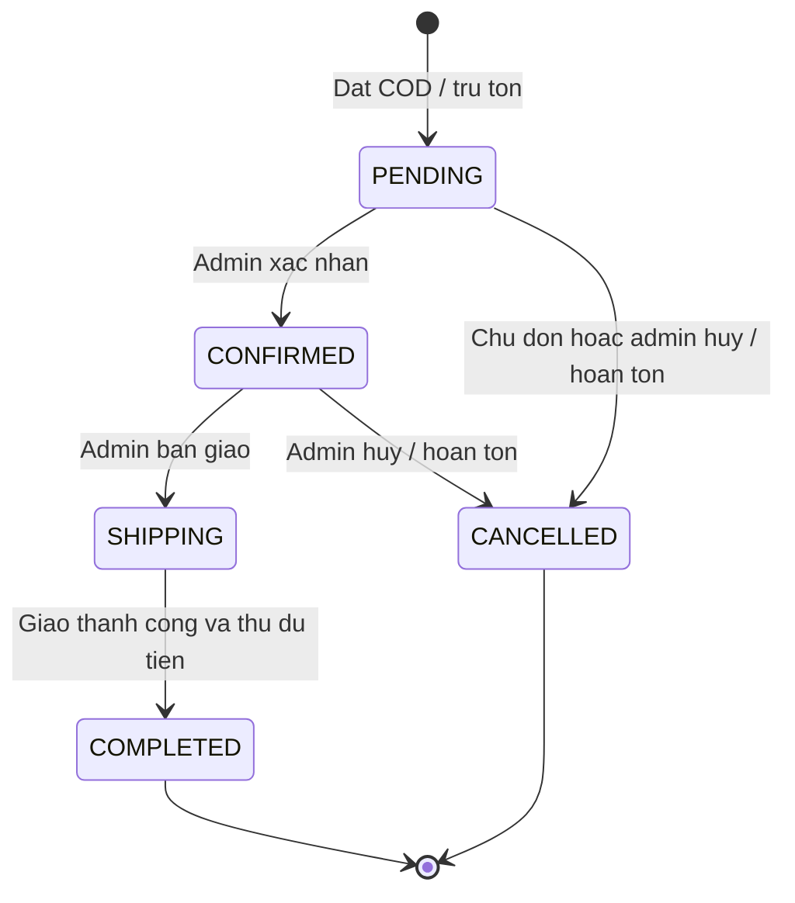

# Quy tắc nghiệp vụ — đề xuất 03/11/2026

Giữ nguyên các yêu cầu bắt buộc của đề bài. Các lựa chọn vận hành chi tiết dưới đây là **đề xuất cần review trước code**, chưa phải chính sách cửa hàng đang hoạt động. Mã BR liên kết với API và nghiệm thu.

## Sản phẩm, giá và dữ liệu

- **BR01:** mỗi quy cách là một SKU (túi 1 kg và 3 kg là hai sản phẩm); một loại có nhiều SKU, mỗi SKU thuộc một loại. Loài DOG/CAT/BOTH, giai đoạn tuổi, thương hiệu và trọng lượng là thuộc tính lọc riêng.
- **BR02:** tên/SKU/loại/giá/trọng lượng bắt buộc; SKU unique, giá VND > 0, trọng lượng gram > 0, tồn nguyên >= 0. Validation trong Java; không tự tạo CHECK/function/procedure. Ảnh lỗi dùng fallback. Đề xuất admin điều chỉnh tồn bằng delta có reason/version và movement audit, không ghi đè tồn từ form sửa catalog; tồn sau điều chỉnh không âm.
- **BR03:** khách chỉ thấy sản phẩm ACTIVE thuộc loại ACTIVE. Hết hàng vẫn xem được, không thêm giỏ/checkout. Tắt loại làm sản phẩm không mua được, không xóa chúng. API và AI dùng cùng điều kiện. Đổi tên/giá không sửa lịch sử đơn.
- **BR04:** không xóa sản phẩm đã có trong bất kỳ order_item nào (kể cả đơn hủy); không xóa loại còn bất kỳ sản phẩm nào (kể cả ẩn). Cho phép ẩn để ngừng bán, nhưng vẫn phải có chức năng xóa đúng điều kiện đề bài. Service transaction + FK bảo vệ xóa/checkout đồng thời.

## Tài khoản và quyền

- **BR05:** email trim/lowercase để so trùng, không tự bỏ dấu chấm hoặc `+tag`; UNIQUE(email_normalized) chống hai lần đăng ký đồng thời. Tên/email/password bắt buộc; điện thoại/địa chỉ có thể nhập tại checkout. Không lưu password gốc, không trả hash qua DTO/log. Đề xuất mật khẩu 8–64 ký tự; chọn encoder hỗ trợ giới hạn và kiểm thử khi triển khai.
- **BR06:** đề xuất đăng ký hợp lệ tạo CUSTOMER ACTIVE, chưa yêu cầu click xác minh email để mua. Mail lỗi không rollback tài khoản; thông báo đã đăng ký và email đang chờ. Không gửi password qua mail.
- **BR07:** login đổi session identifier nhưng giữ giỏ guest; logout hủy phiên và đề xuất xóa giỏ để bảo vệ máy dùng chung. Hết Session trả 401 cho API yêu cầu login, không tự gửi lại thao tác mua sau login. CSRF cho mutation kể cả login/logout. Backend quyết định quyền.
- **BR08:** admin tìm user theo email/tên/trạng thái, sửa tên/điện thoại/trạng thái; email và role đề xuất chỉ đọc trong v1. Không khóa/xóa chính admin đang thao tác hoặc admin ACTIVE cuối cùng. Tài khoản bị khóa mất quyền từ request tiếp theo: kiểm tra trạng thái hiện hành, không chỉ tin role trong Session cũ. Customer chỉ sửa hồ sơ mình.
- **BR09:** chỉ xóa user chưa có đơn nào, kể cả đơn hủy. Xóa hồ sơ thú cưng và phụ thuộc cá nhân trong transaction; từ chối nếu phát sinh đơn đồng thời. Thu hồi Session sau đó. Audit giữ actor_id nullable/mã sự kiện tối thiểu, không chép PII để né xóa. User đã có đơn chỉ cho khóa.

## Giỏ và checkout

- **BR10:** giỏ lưu productId/quantity trong Session Redis, không có bảng giỏ PostgreSQL. Đề xuất 1–99 mỗi dòng và tối đa 50 SKU. Quantity=0 không hợp lệ, dùng xóa dòng. Thêm cùng SKU cộng số lượng nhưng không vượt giới hạn/tồn hiện hành. Giỏ không giữ hàng. Redis lỗi thông báo không thao tác được, không âm thầm chuyển sang giỏ khác.
- **BR11:** backend tính `subtotal = sum(unitPrice × quantity)`, `grandTotal = subtotal + shippingFee`; không tin giá/tổng client. BigDecimal/numeric, VND không phần thập phân. Đề xuất phí ship demo=0, hiển thị rõ “Miễn phí giao hàng trong bản demo”; chưa có thuế/phụ phí/voucher. Preview trả quoteToken gắn user, cart revision, SKU/số lượng/giá/phí, hạn 10 phút.
- **BR12:** checkout cần CUSTOMER/ADMIN ACTIVE, giỏ có hàng, tên người nhận/điện thoại/địa chỉ hợp lệ, phương thức COD. So quote với giá/giỏ hiện hành; thay đổi trả 409 để xem lại, không chấp nhận tăng giá ngầm. Kiểm tra ACTIVE của sản phẩm/loại và tồn tất cả dòng khi lập đơn.
- **BR13:** tạo đơn/chi tiết, trừ tồn khả dụng, lịch sử và email event trong **một transaction PostgreSQL**. Khóa SKU theo thứ tự ID nhất quán; thiếu một dòng rollback cả đơn, giữ giỏ. Tồn không âm khi hai khách mua đơn vị cuối. Trừ tồn ngay khi tạo PENDING, không giữ hàng riêng trong giỏ.
- **BR14:** client giữ một Idempotency-Key khi retry do mất mạng. DB unique (customer_id, key), lưu fingerprint của cart revision, quoteToken, địa chỉ, phương thức. Cùng key/fingerprint trả đơn cũ; khác nội dung trả 409. Replay được kiểm tra trước điều kiện giỏ chưa xóa/quote chưa hết hạn. Redis và PostgreSQL không atomic: commit xong mới xóa giỏ đúng revision đã mua; giỏ mới ở tab khác được giữ. Redis lỗi sau commit vẫn trả đơn thành công và retry cleanup; reconcile cart revision đã mua với đơn trước checkout mới để chặn tạo lại bằng key khác.
- **BR15:** snapshot tên/SKU/đơn giá và địa chỉ trong đơn; đổi catalog/hồ sơ không đổi lịch sử. Khách chỉ xem đơn mình; truy cập ID người khác trả 404. Admin xem mọi đơn qua namespace admin riêng.

## Vòng đời đơn COD

**BR16 — trạng thái đề xuất:**

| Thao tác | Actor | Quy tắc |
|---|---|---|
| Sửa số lượng | Admin | Chỉ PENDING/CONFIRMED, nguyên 1–99; không thêm/xóa dòng trong v1; giữ giá snapshot, tính lại tổng |
| Tăng | Admin | Trừ chênh lệch tồn, đủ tồn và sản phẩm/loại ACTIVE; không đủ rollback |
| Giảm | Admin | Hoàn chênh lệch tồn; không sửa thành 0; muốn bỏ toàn đơn dùng hủy |
| Hủy | Chủ đơn khi PENDING; admin khi PENDING/CONFIRMED | Có lý do; hoàn số lượng hiện tại của từng dòng đúng một lần |
| Hoàn thành | Admin khi SHIPPING | Xác nhận đã giao/thu đủ COD, paymentStatus=PAID, lưu paidAt |
| Đơn kết thúc | Không sửa | COMPLETED/CANCELLED không quay lui, không sửa số lượng, không xóa đơn |

- **BR17:** sửa số lượng/trạng thái mang version; version cũ trả 409. Tồn/tổng/version/lịch sử cập nhật cùng transaction; kiểm tra status sau khi khóa đơn. Hủy lặp không hoàn tồn lần hai. Sản phẩm đã ẩn vẫn cho giảm/hủy, không tăng.
- **BR18:** COD tạo UNPAID, đơn hủy chưa thu tiền, COMPLETED mới PAID. Doanh thu chỉ cộng COMPLETED/PAID. Đơn mặc định createdAt giảm dần, ID làm khóa sắp xếp phụ; lưu thời điểm UTC, UI hiển thị Asia/Ho_Chi_Minh.

Giới hạn demo: chưa xử lý trả hàng/hoàn tiền/thu thiếu/giao thất bại. Đơn SHIPPING gặp sự cố giữ trạng thái và ghi chú, không giả hoàn thành/hủy. Cần quy trình hoàn hàng trước vận hành thật.

## Email và phục hồi lỗi

- **BR19:** email event nằm trong transaction tạo user/đơn; worker gửi sau commit. Mailpit cho local, SMTP thật theo cấu hình. Mail đơn gồm mã/dòng hàng/tổng/địa chỉ và COD; không thông báo đã thanh toán chỉ vì đặt thành công.
- **BR20:** retry backoff, PENDING/SENT/FAILED, đề xuất 3 lần rồi admin retry. Không tạo lại đơn/user khi mail lỗi. Gửi at-least-once: eventId cố định hạn chế trùng nhưng không hứa SMTP exactly-once khi mất xác nhận sau gửi. Không log nội dung mail hoặc PII công khai.

## Hồ sơ, AI và tracking

- **BR21:** hồ sơ thú cưng thuộc customer, tên/loài bắt buộc, ngày sinh hoặc tuổi ước lượng/cân nặng/sở thích tùy chọn. Không bắt buộc để mua; không đọc hồ sơ người khác. Xóa hồ sơ không xóa đơn.
- **BR22:** AI truy xuất nội dung được duyệt rồi đọc lại ACTIVE/giá/tồn từ DB; loài/tuổi/ngân sách khách nêu là điều kiện cứng. Hỏi khi chưa rõ; tối đa 3 gợi ý có lý do/link; không bịa thành phần/công dụng chữa bệnh. Không có kết quả thì nói không có, không tự nới điều kiện. Nội dung truy xuất không có quyền ra lệnh cho model.
- **BR23:** vector gắn productId/contentVersion/modelId; đổi nội dung lập tác vụ cập nhật; ẩn/xóa loại khỏi kết quả ngay cả khi vector chưa kịp xóa. Không trộn model/dimension. Provider/ngân sách/dimension còn mở; chưa tạo vector table khi chưa chọn model. AI lỗi/quota thì fallback lọc thường, không chặn mua.
- **BR24:** tracking tùy chọn/cá nhân hóa mặc định chưa bật; lựa chọn riêng analytics và personalization. Chỉ dùng hành vi với quyền tương ứng; vẫn có thể tư vấn theo hồ sơ khách chủ động chọn. Guest dùng ID phiên ẩn danh, không fingerprint; không tự nối lịch sử trước consent vào tài khoản.
- **BR25:** UI event có eventId unique, tên theo whitelist, server_received_at làm mốc chính. Đơn thành công phát sinh từ backend. Đơn vẫn lưu như nghiệp vụ khi từ chối analytics nhưng không sao chép sang tracking theo user. Không đưa email/địa chỉ/password vào events, embedding hoặc API AI. Giới hạn và loại PII của search text; ưu tiên bộ lọc chuẩn hóa thay raw query.
- **BR26:** đề xuất raw events giữ 90 ngày, có job dọn; rút quyền ngừng ghi mới và xóa dữ liệu cá nhân hóa liên quan, không xóa đơn nghiệp vụ. Dashboard ghi rõ tập khách đồng ý, cửa sổ ngày và dữ liệu demo. Funnel dùng distinct session đi đúng thứ tự trong phiên. CTR = số impressionId có click / số impressionId đã hiển thị; không đếm lặp. Gắn recommendationId/impressionId; không gọi tương quan là doanh thu do AI tạo ra.

## Quyết định cần review trước triển khai

| ID | Đề xuất | Lý do / tác động |
|---|---|---|
| D01 | SKU theo quy cách, một loại/SKU | Giảm phức tạp biến thể |
| D02 | Trừ tồn ở PENDING, hoàn khi hủy | Chống bán vượt tồn; admin phải xử lý đơn treo, chưa tự hủy theo thời gian |
| D03 | Chỉ sửa số lượng ở PENDING/CONFIRMED | Đáp ứng đề bài, không sửa hàng đang giao |
| D04 | Khách hủy PENDING, admin hủy trước SHIPPING | Tự phục vụ có giới hạn |
| D05 | Ship demo=0, VND | Không giả tích hợp vận chuyển |
| D06 | Chưa bắt buộc xác minh email; email/role chỉ đọc trong admin v1 | Giảm scope xác minh/đổi quyền |
| D07 | Tracking opt-in, raw 90 ngày | Đề xuất cho đồ án, không khẳng định là yêu cầu pháp luật |
| D08 | 50 SKU/giỏ, 1–99/dòng, quote 10 phút, mail retry 3 lần | Cấu hình được, cần review |

Nếu đổi D01–D08, cập nhật API/dữ liệu/acceptance tương ứng. Không coi đề xuất là người dùng đã phê duyệt.
