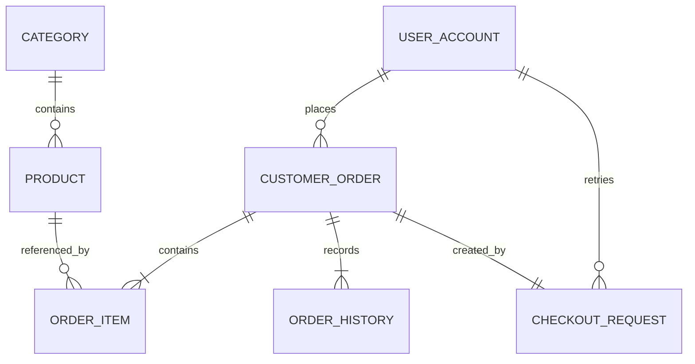

# Mô hình miền dự kiến — 03/11/2026

Thiết kế logic phục vụ review, **chưa phải migration/entity hiện có**. V1 hiện chỉ bật pgvector. Không sửa V1; sau khi thống nhất thêm V2 cho nghiệp vụ P0, migration P1 sau đó. Các lựa chọn vận hành tham chiếu [BR/D](BUSINESS_RULES.md).

## Quan hệ P0

## Bảng/thuộc tính chính

| Bảng | Thuộc tính quan trọng | Toàn vẹn / lưu ý |
|---|---|---|
| user_account | id, email_normalized, display_name, password_hash, phone, role, status, created_at, version | Email UNIQUE; role CUSTOMER/ADMIN; status ACTIVE/LOCKED; không DTO password/hash |
| category | id, name, slug, status, version | Slug UNIQUE; không xóa khi còn product |
| product | id, sku, category_id, name, description, species, life_stage, brand, weight_grams, price, available_stock, image_url, status, content_version, version | SKU UNIQUE; FK category RESTRICT; tuổi từ metadata nhãn sản phẩm, không suy từ AI |
| customer_order | id, order_code, customer_id, status, payment_method, payment_status, recipient_name, phone, address_text, subtotal, shipping_fee, grand_total, created_at, paid_at, version | Order code UNIQUE; FK customer RESTRICT; nhận hàng/giá là snapshot |
| order_item | id, order_id, product_id, sku_snapshot, name_snapshot, unit_price, quantity, line_total | UNIQUE(order_id, product_id); FK product RESTRICT, không cascade xóa lịch sử |
| order_history | id, order_id, actor_id nullable, action, from_status, to_status, quantity_change, reason, created_at | Append-only; ghi cả sửa quantity và chuyển trạng thái; không lưu PII không cần thiết |
| checkout_request | id, customer_id, idempotency_key, fingerprint, cart_token, cart_revision, order_id | UNIQUE(customer_id, key), UNIQUE(cart_token, cart_revision), order_id UNIQUE; lưu cùng transaction đơn |
| notification_outbox | id/event_id, type, aggregate_id, payload, status, attempts, next_attempt_at, created_at, sent_at | Type REGISTRATION/ORDER_PLACED; payload tối thiểu cần gửi mail, không log payload; retry theo BR20 |
| inventory_movement | id, product_id nullable, sku_snapshot, order_id nullable, actor_id nullable, delta, reason, created_at | FK product ON DELETE SET NULL; ghi biến động tồn cùng transaction cập nhật product; snapshot giữ lịch sử SKU |

Event `ORDER_PLACED` là tiếp nhận đặt hàng, không đồng nghĩa order status CONFIRMED của admin. Với SKU chưa từng có order_item, lịch sử điều chỉnh tồn không được làm mất khả năng xóa theo đề bài: khi xóa hợp lệ, product_id của movement thành null và sku_snapshot giữ nguyên; không cascade xóa movement. FK RESTRICT từ order_item vẫn ngăn xóa sản phẩm đã có đơn.

Tiền dùng numeric/BigDecimal; version dùng optimistic concurrency. Enum/giới hạn số và giá được validate ở Java; FK/PK/UNIQUE trong DB. Không tự viết CHECK/function/stored procedure. Index dự kiến: product(category_id,status), order(customer_id,created_at,id), order(status,created_at,id), outbox(status,next_attempt_at).

Giỏ không có bảng. Redis Session lưu cartToken ngẫu nhiên (không phải auth session ID), revision tăng mỗi lần sửa, các dòng productId/quantity. Quote lưu TTL riêng trong Redis, gắn user/cartToken/revision và snapshot giá. Không dùng auth session ID làm idempotency key.

`checkout_request` và order cùng transaction: chỉ lưu request thành công; hai request cùng key phải đồng bộ qua unique/locking và trả cùng đơn. Không giữ một bản ghi PROCESSING vĩnh viễn sau rollback. Cart revision unique giúp ngăn mua lại giỏ đã commit khi Redis cleanup thất bại. Replay tra cứu fingerprint trước khi kiểm tra quote TTL.

## P1 — thêm sau core

| Bảng / dữ liệu | Quan hệ và mục đích |
|---|---|
| pet_profile | FK owner, tên/loài/ngày sinh hoặc tuổi ước lượng/cân nặng/sở thích; chỉ owner đọc/sửa |
| consent_preference | FK user hoặc anonymous token, analytics/personalization riêng, version và thời điểm thay đổi; không thu sự kiện trước consent |
| behavior_event | event_id UNIQUE, name, anonymous session token, user nullable, product nullable, recommendation/impression IDs, server_received_at, metadata whitelist, is_demo |
| product_embedding | FK product, content_version, model_id, nội dung được duyệt, embedding; dimension quyết định theo model, không hard-code lúc này |
| embedding_job | Product/content version, trạng thái/retry; tránh trả vector cũ hoặc cập nhật ngược version |

Không cần lưu vector của từng hành vi hoặc embedding hồ sơ cá nhân. Recommendation/impression IDs phải được backend cấp và đối chiếu để giảm event giả; chưa cần bảng hội thoại dài hạn cho demo.

## Xóa và lịch sử

- Category → product, product → order_item, user → order: RESTRICT. Không cascade từ user/product sang order.
- Xóa user chưa đặt hàng: xóa pet/consent và dữ liệu cá nhân liên quan; audit actor chuyển null; outbox chưa gửi của user bị xóa cần hủy, payload đã gửi được dọn theo retention. Không gửi mail đăng ký sau khi tài khoản đã bị xóa.
- Rút tracking: ngừng thu mới, xóa events/profiles cá nhân hóa gắn token/user theo BR26; đơn vẫn giữ riêng. Raw tracking 90 ngày là đề xuất, chưa có job chạy.
- Product ẩn/xóa: bộ lọc DB loại khỏi AI ngay; vector/job liên quan được cleanup. Snapshot đơn không thay đổi.

## Điểm cần review trước V2

1. Thống nhất D01–D08, trường nhận hàng và phạm vi admin cập nhật tài khoản.
2. Chốt từ điển loại/loài/tuổi dựa trên dữ liệu sản phẩm thực tế.
3. Chốt quy tắc audit/outbox cleanup; xác định dữ liệu demo và dữ liệu cá nhân cần tránh.
4. P0 không phụ thuộc nhà cung cấp AI; P1 mới chốt model/dimension và migration embedding.
