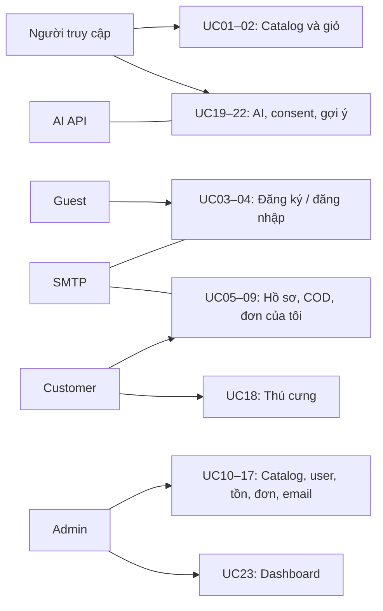

# Thiết kế UML

**Đã bổ sung:** [8 Activity Diagram có nguồn và SVG](activities/README.md) cho P0: COD, đăng ký/login, giỏ, sửa/trạng thái đơn, xóa dữ liệu và email nền. Các giả định nghiệp vụ được đánh dấu, chưa phải chức năng đã lập trình.

Xem [Use Case Diagram SVG](use-cases.svg), [nguồn PlantUML](use-cases.puml) và [đặc tả UC01–UC23](../USE_CASES.md).

Bản đồ dưới đây dùng Mermaid để đọc ngay trên GitHub; **đây là bản đồ chức năng, không thay thế ký pháp UML use case**. Các nhóm chỉ để trình bày; sơ đồ PlantUML liệt kê đủ từng UC và quan hệ kế thừa actor.

SMTP thực tế chỉ hỗ trợ UC03/07/17, không login hay các use case khác trong nhóm. AI API hỗ trợ UC19/20; consent không cần AI. Guest/Customer đều có khả năng Người truy cập; Admin có khả năng Customer.

Không dùng include/extend để biểu diễn thứ tự trang hoặc điều hướng. Đăng nhập là tiền điều kiện checkout; thêm giỏ không bắt buộc phải được gọi trong mỗi lần xem sản phẩm. Email nền là bước hỗ trợ bất đồng bộ được đặc tả bằng luồng/sequence, không buộc SMTP thành công để UC03/07 thành công.

[Domain Class Diagram và ERD P0](domain-erd.md) mô tả quan hệ nghiệp vụ, ranh giới Redis/PostgreSQL và các khóa bảo vệ luồng COD. Chi tiết thuộc tính nằm trong [DOMAIN_MODEL.md](../DOMAIN_MODEL.md).

[Sequence Diagram](sequences/README.md) mô tả checkout COD, đăng ký khi SMTP lỗi và hai admin sửa cùng đơn. [Design Class Diagram](design-class.md) mô tả trách nhiệm các lớp cho ba luồng.
