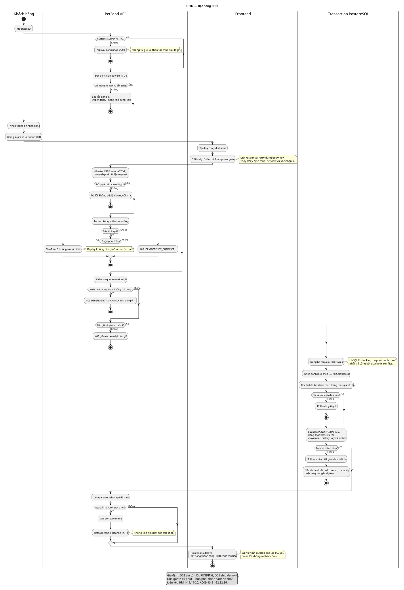
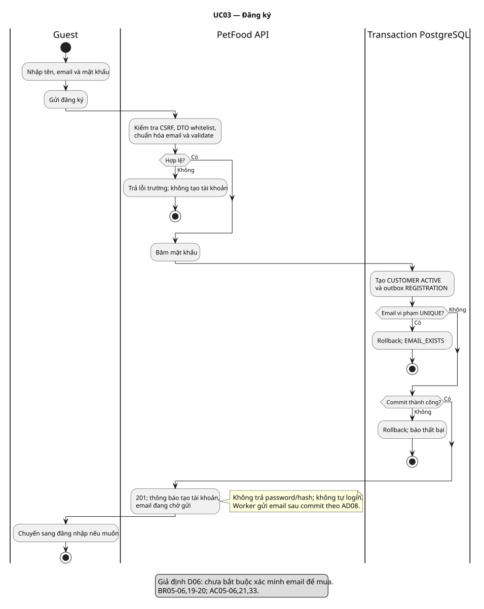
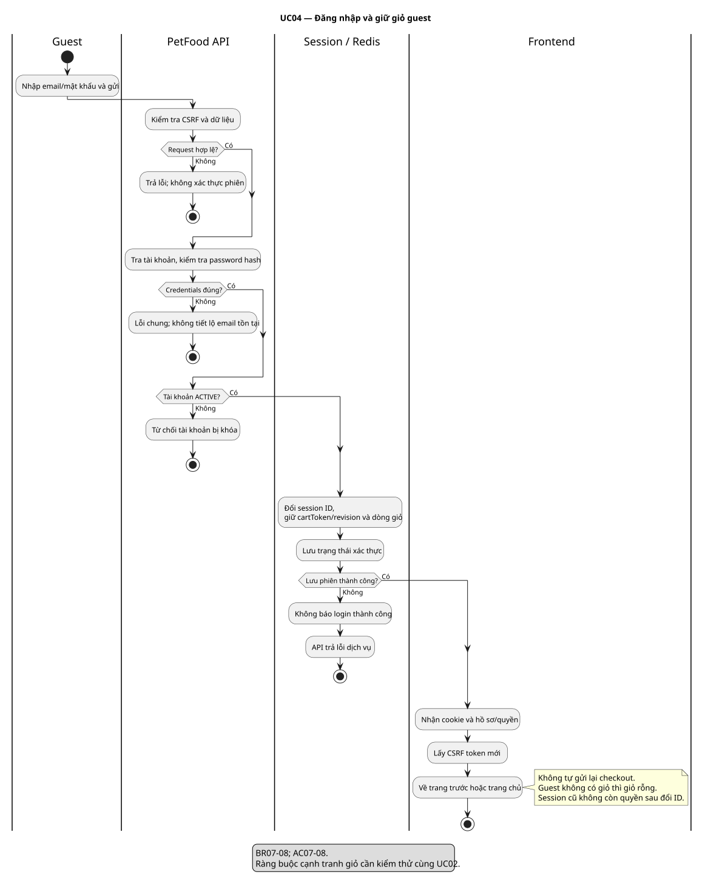
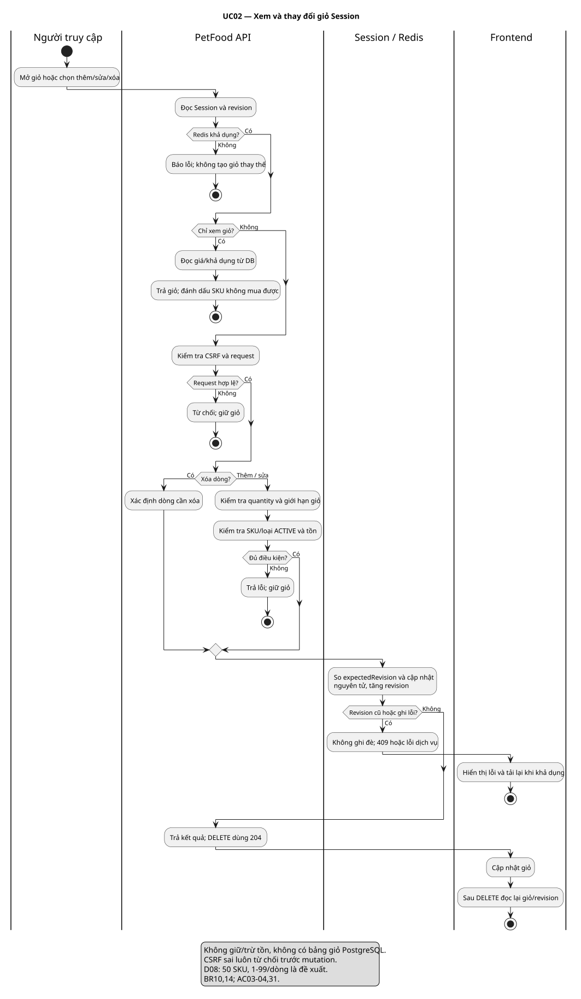
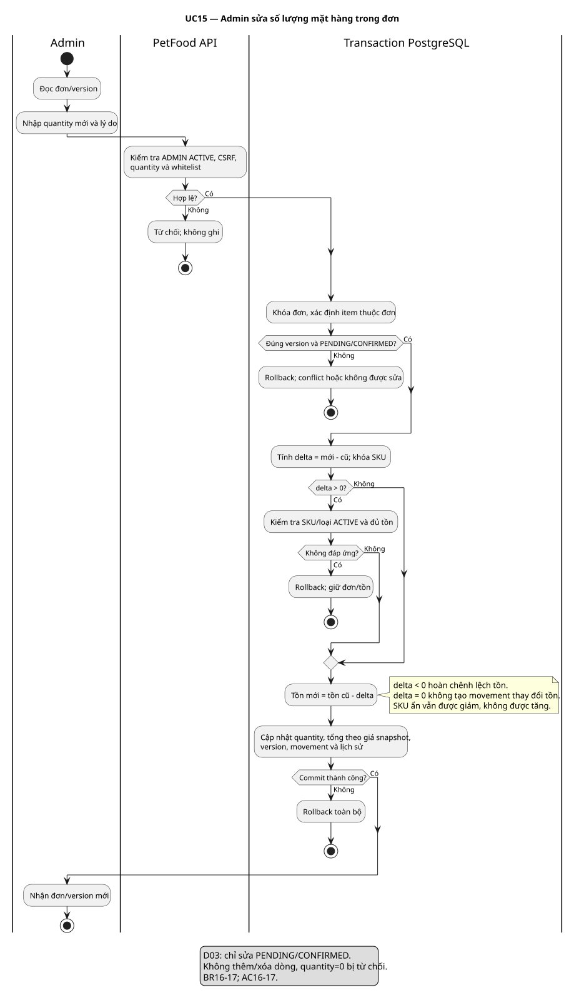
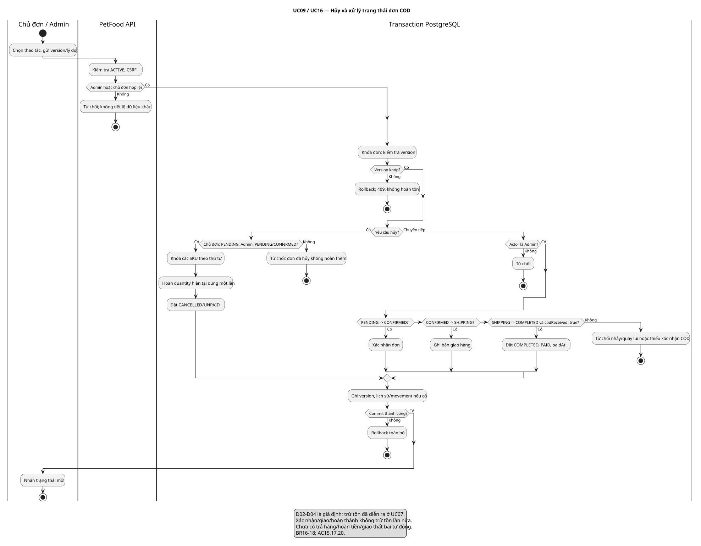
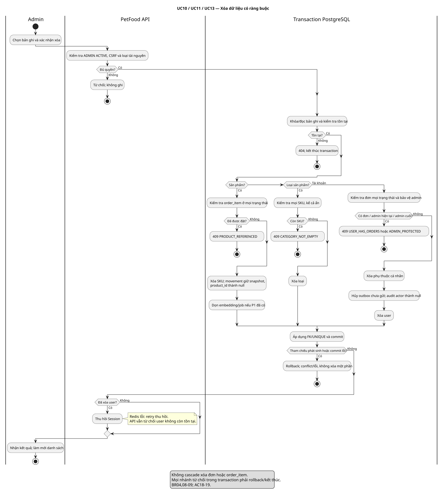
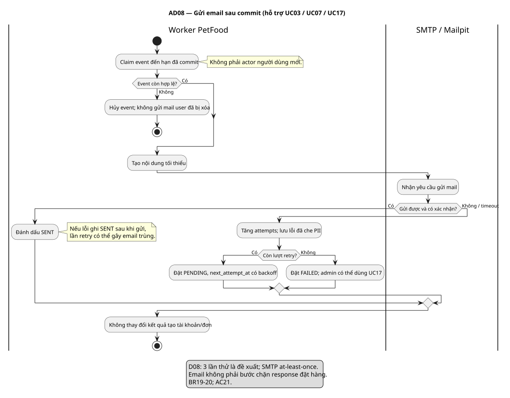

# Activity Diagram — 04/11/2026

Bộ sơ đồ hoạt động cho [use case](../../USE_CASES.md) P0. Swimlane thể hiện trách nhiệm xử lý, không phải actor mới trong Use Case Diagram. Các sơ đồ là thiết kế dự thảo, chưa xác nhận chức năng chạy.

Nguồn `.puml` là bản chỉnh sửa chính; `.svg` là bản xuất cùng tên để xem trực tiếp trên GitHub và dùng trong báo cáo. Giữ nguồn và ảnh đồng bộ khi thay đổi. Điều kiện trong hình tham chiếu [BUSINESS_RULES](../../BUSINESS_RULES.md); tất cả giới hạn D01–D08 vẫn là giả định cần review.

| Sơ đồ | Nội dung | Nguồn | Ảnh | Nghiệm thu |
|---|---|---|---|---|
| AD01 / UC07 | Checkout COD, replay, transaction, cleanup | [PlantUML](uc07-checkout.puml) | [SVG](uc07-checkout.svg) | AC09–13,21–22,32,36 |
| AD02 / UC03 | Đăng ký, unique email, outbox | [PlantUML](uc03-register.puml) | [SVG](uc03-register.svg) | AC05–06,21,33 |
| AD03 / UC04 | Login, giữ giỏ, đổi session ID | [PlantUML](uc04-login.puml) | [SVG](uc04-login.svg) | AC07–08 |
| AD04 / UC02 | Giỏ nhiều tab, atomic revision | [PlantUML](uc02-cart.puml) | [SVG](uc02-cart.svg) | AC03–04,31 |
| AD05 / UC15 | Sửa quantity, delta tồn, snapshot giá | [PlantUML](uc15-order-quantity.puml) | [SVG](uc15-order-quantity.svg) | AC16–17 |
| AD06 / UC09,16 | Hủy/xác nhận/giao/hoàn thành COD | [PlantUML](uc09-16-order-status.puml) | [SVG](uc09-16-order-status.svg) | AC15,17,20 |
| AD07 / UC10,11,13 | Xóa SKU/loại/user theo ràng buộc | [PlantUML](uc10-11-13-delete.puml) | [SVG](uc10-11-13-delete.svg) | AC18–19 |
| AD08 / hỗ trợ UC03,07,17 | Worker gửi và retry email | [PlantUML](ad08-email-worker.puml) | [SVG](ad08-email-worker.svg) | AC21 |

## Cách đọc

- Mỗi sơ đồ mô tả một lần thực hiện. Khi kết thúc bằng lỗi, người dùng có thể sửa dữ liệu và khởi động lại; không tự lặp mutation nếu chưa biết kết quả.
- Checkout replay vẫn kiểm tra actor/ownership/CSRF; chỉ bỏ qua giỏ hoặc quote đã tiêu thụ. Mất response phải dùng cùng key/body. Giá thay đổi cần khách xác nhận lại và key mới.
- Lane PostgreSQL khoanh trách nhiệm transaction; mọi nhánh từ chối phải kết thúc/rollback, không giữ khóa. Unique conflict do cạnh tranh cần đọc lại kết quả đã commit theo BR14, không âm thầm đặt thêm đơn.
- Redis cleanup nằm sau commit DB; compare-and-clear không xóa revision mới. Lỗi cleanup không đổi đơn thành thất bại. Chi tiết khóa/CAS sẽ thể hiện trong Sequence Diagram.
- Đăng ký và đặt hàng chỉ ghi outbox trong transaction; AD08 chạy độc lập sau commit, không phải bước chờ để UI báo thành công.
- Với UC09/16, quyền chủ đơn và quyền admin được phân biệt theo thao tác; không cho customer chuyển đơn sang SHIPPING hoặc COMPLETED.
- Việc xóa dữ liệu P1 (vector, pet, consent) chỉ áp dụng khi module đó tồn tại. Không thêm trạng thái outbox mới chỉ để diễn giải “hủy event”: worker bỏ event không còn hợp lệ theo thiết kế cleanup của module.

## Checkout COD



## Đăng ký



## Đăng nhập



## Giỏ hàng



## Sửa số lượng đơn



## Xử lý trạng thái đơn



## Xóa có ràng buộc



## Email nền



## Tái tạo và kiểm chứng

Dùng Java và PlantUML JAR từ bản phát hành chính thức. Lần xuất này dùng **PlantUML 1.2026.9**; JAR/tool tạm không đưa vào repo. Tại repo root, thay `/path/to/plantuml.jar` bằng đường dẫn thật:

```text
java -jar /path/to/plantuml.jar -charset UTF-8 -checkonly docs/design/activities
java -jar /path/to/plantuml.jar -charset UTF-8 -tsvg docs/design/activities
```

Sơ đồ activity dùng cú pháp mới, có thể render mà không cài Graphviz. Kiểm chứng tài liệu/sơ đồ không thay thế test hành vi AC. Bước tiếp theo: Domain Class Diagram và ERD; sau đó Sequence để kiểm tra khóa, transaction, idempotency và lỗi dịch vụ.

Kết quả kiểm chứng lần này: 8 nguồn qua kiểm tra cú pháp, xuất SVG/PNG thành công; đã xem bản render để kiểm tra bố cục và chữ tiếng Việt. Liên kết tài liệu/ảnh được kiểm tra tồn tại. PNG và công cụ render được giữ trong vùng làm việc tạm; repo lưu nguồn và SVG.
