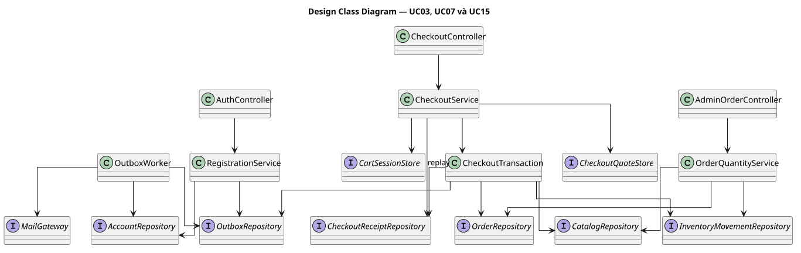

# Design Class Diagram P0

[Nguồn PlantUML](design-class.puml) · [Sequence](sequences/README.md) · [Domain Class và ERD](domain-erd.md)

Đây là thiết kế trách nhiệm cho UC03, UC07 và UC15. Controller áp dụng xác thực, phân quyền và validation theo từng endpoint. Repository là cổng đọc/ghi PostgreSQL. OrderRepository lưu cả dòng đơn và lịch sử trong transaction của nghiệp vụ.

- **RegistrationService** lưu tài khoản và outbox cùng transaction. OutboxWorker xử lý SMTP sau commit.
- **CheckoutService** điều phối báo giá, replay và Redis. **CheckoutTransaction** ghi đơn, receipt, tồn, audit và outbox trong một transaction. CheckoutService chỉ dọn giỏ khi kết quả commit đã được xác nhận.
- **OrderQuantityService** lấy khóa đơn trước, kiểm tra version, khóa catalog và lưu thay đổi cùng audit. Khi có version conflict, UI tải lại đơn trước khi admin quyết định gửi yêu cầu mới.

Tên lớp và cổng lưu trữ là đề xuất triển khai.
