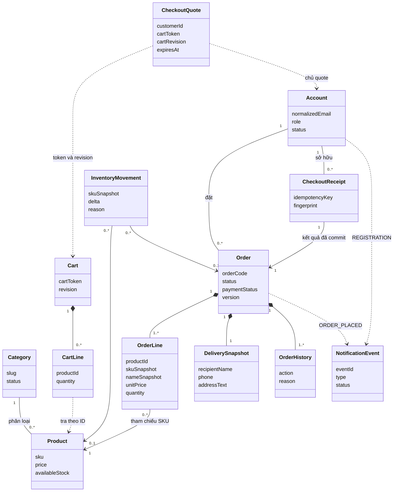
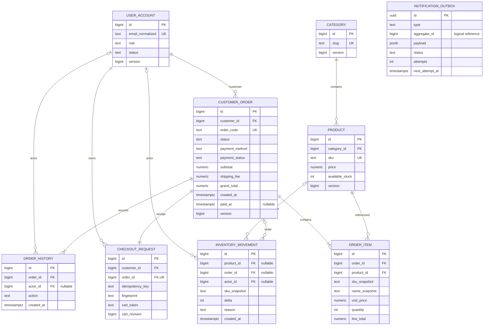

# Domain Class Diagram và ERD — P0

Phạm vi gồm catalog, tài khoản, giỏ Session, checkout COD, quản lý đơn, tồn kho và email nền. Đây là thiết kế đề xuất cho V2. Các quyết định D01–D08 vẫn cần review theo [quy tắc nghiệp vụ](../BUSINESS_RULES.md).

## Domain Class Diagram

Guest là actor có giỏ trong Session. CUSTOMER và ADMIN là vai trò của Account. DeliverySnapshot là value object được lưu trong hàng đơn. Quote lưu riêng trong Redis có TTL và gắn với người dùng, cartToken và revision. Dòng giỏ tham chiếu product bằng ID, nên backend cần kiểm tra lại khả năng bán và tồn kho khi checkout.

## ERD PostgreSQL

Các kiểu dữ liệu là đề xuất. Sơ đồ hiển thị cột phục vụ quan hệ và toàn vẹn. Danh sách trường nghiệp vụ còn lại nằm trong [mô hình miền](../DOMAIN_MODEL.md). Bảng outbox đứng riêng vì aggregate_id trỏ logic đến Account hoặc Order theo type.

Backend ghi customer_id của receipt và đơn từ cùng tài khoản đã xác thực trong transaction. Bội số bắt buộc từ đơn đến receipt, dòng đơn và lịch sử mô tả trạng thái sau commit. Backend bảo đảm các bản ghi đi kèm được tạo cùng đơn.

| Điểm cần bảo vệ | Cách thiết kế |
|---|---|
| Xóa danh mục, sản phẩm hoặc khách đã đặt hàng | FK từ product đến category, order_item đến product và customer_order đến user dùng RESTRICT. Kiểm tra ở API để trả lỗi rõ ràng. FK bảo vệ khi có ghi đồng thời. |
| Giữ audit khi xóa hợp lệ | FK product của movement và FK actor của audit dùng SET NULL. Giữ sku_snapshot. checkout_request thuộc đơn đã tạo, nên quan hệ này không chặn xóa thêm trường hợp user chưa từng đặt hàng. |
| Chống tạo đơn trùng | UNIQUE trên (customer_id, idempotency_key), (cart_token, cart_revision) và order_id. Cùng key và fingerprint trả đơn cũ. Cùng key khác fingerprint bị từ chối. Kiểm tra replay trước khi kiểm tra TTL quote. |
| Giữ giá và địa chỉ lịch sử | UNIQUE(order_id, product_id). Đơn giữ snapshot thông tin nhận hàng, dòng đơn giữ SKU, tên và đơn giá. Sửa số lượng tính lại từ giá snapshot. |
| Nhất quán đơn và tồn | Một transaction lưu đơn, dòng, receipt, lịch sử, cập nhật tồn và ghi movement, outbox. Java kiểm tra trạng thái, số lượng, tồn và đơn phải có ít nhất một dòng. DB dùng PK/FK/UNIQUE và NOT NULL theo trường bắt buộc. |
| COD, Session và email | Đơn khởi tạo PENDING/UNPAID. Sau commit mới xóa giỏ theo đúng token/revision. Worker gửi mail từ outbox và retry độc lập. |

Ba tình huống cần đối chiếu khi review V2:

- Xóa SKU từng xuất hiện trong đơn bị chặn, kể cả đơn đã hủy. SKU chỉ có lịch sử điều chỉnh tồn vẫn xóa được và movement giữ snapshot.
- Client mất phản hồi sau commit và gửi lại cùng key. API trả cùng mã đơn, không trừ tồn hoặc ghi email event lần hai, kể cả quote đã hết hạn.
- Admin đổi giá sau checkout. Đơn đã lưu hiển thị giá mua cũ và dùng giá đó khi sửa số lượng hợp lệ.

Tiếp theo dùng ERD này để dựng Sequence Diagram UC07, đặc biệt ở nhánh replay, khóa tồn, rollback và dọn giỏ sau commit.
