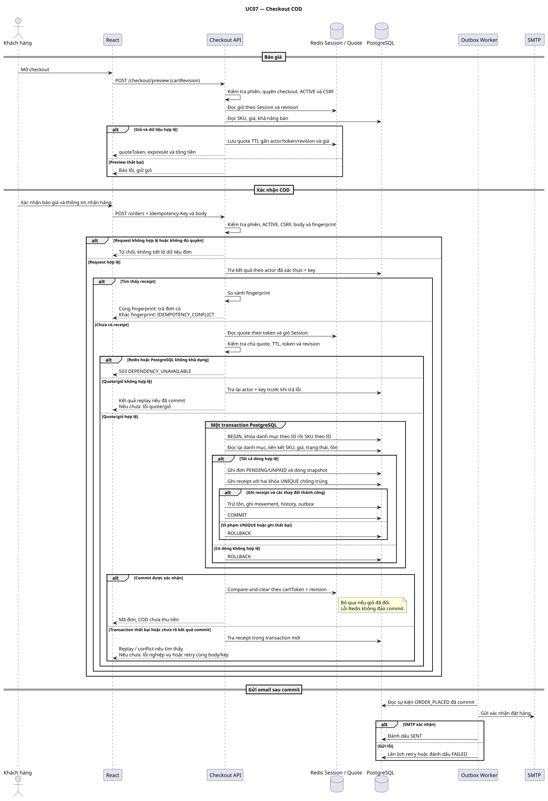

# Sequence Diagram UC07 — Checkout COD

Các sơ đồ liên quan: [UC03 đăng ký và lỗi SMTP](uc03-register.svg) ([nguồn](uc03-register.puml)) · [UC15 hai admin sửa cùng đơn](uc15-order-quantity.svg) ([nguồn](uc15-order-quantity.puml)).

[Nguồn PlantUML](uc07-checkout.puml) · [Activity Diagram UC07](../activities/uc07-checkout.puml) · [ERD P0](../domain-erd.md) · [API contract](../../API_CONTRACT.md)

- **Replay.** Xác thực trước khi tra receipt bằng actor + key. Receipt cùng fingerprint cho phép trả đơn cũ dù quote hết hạn hoặc giỏ đã bị dọn. Trường hợp khác fingerprint trả `IDEMPOTENCY_CONFLICT`.
- **Cạnh tranh.** Khóa SKU theo thứ tự ID. Các khóa unique trên (customer_id, idempotency_key) và (cart_token, cart_revision) bảo vệ cả trường hợp hai request dùng key khác nhau cho cùng giỏ. Nếu vi phạm unique, rollback toàn bộ trước khi tra lại bằng transaction mới. Cùng actor/key và fingerprint trả đơn cũ. Key khác cho cùng revision trả conflict, không trả thông tin đơn của actor khác. Việc tra lại khi kiểm tra giỏ, quote hoặc tồn thất bại giúp nhận ra request cạnh tranh đã commit.
- **Kết quả commit chưa rõ.** Nếu mất kết nối khi COMMIT, tra receipt khi DB khả dụng. Nếu chưa xác định được kết quả, frontend giữ nguyên body/key để retry. Khi xác nhận được đơn đã commit, lần cleanup được phép dùng compare-and-clear với token và revision gốc của giỏ hiện tại. Nếu giỏ đã đổi hoặc Redis đang lỗi thì giữ kết quả đơn. Cleanup phải giữ phiên đăng nhập.
- **Báo giá lại.** Nếu chưa có receipt và nhận `PRICE_CHANGED`, `QUOTE_EXPIRED` hoặc `CART_CHANGED`, frontend lập quote mới và dùng key mới sau khi khách xác nhận lại. Tồn chỉ thay đổi trong transaction tạo đơn. Email chạy độc lập sau commit.

D02, D05 và D08 vẫn là đề xuất. Tham chiếu BR11–15, BR19–20 và AC09–13, AC21–22, AC32, AC36.

## Khóa catalog và AC36

Đề xuất khóa hàng PostgreSQL đến hết transaction. Với thao tác sửa đơn, khóa đơn trước. Sau đó khóa các danh mục theo ID tăng dần, rồi các SKU theo ID tăng dần. Checkout đọc lại liên kết danh mục của từng SKU dưới khóa. Nếu liên kết đã đổi so với tập danh mục dự kiến, rollback và bắt đầu lại với tập khóa mới. Thao tác ẩn danh mục khóa cùng hàng danh mục. Ẩn SKU khóa hàng SKU. Chuyển danh mục khóa cả danh mục cũ và mới trước SKU rồi kiểm tra lại liên kết. Các thao tác cần cả hai loại khóa tuân cùng thứ tự.

| Thứ tự trong AC36 | Kết quả cần kiểm thử |
|---|---|
| Ẩn danh mục hoặc SKU lấy khóa trước và commit | Checkout đọc lại trạng thái ẩn, rollback và giữ giỏ. Không tạo đơn, trừ tồn hay ghi email event. |
| Checkout lấy các khóa liên quan trước và commit | Thao tác ẩn chờ khóa. Đơn giữ snapshot hợp lệ. Sau khi thao tác ẩn commit, các checkout mới bị từ chối. |

Lỗi quote/giỏ hoặc giá đổi trả 409 theo API contract. Dependency không khả dụng trả 503 khi chưa thể trả kết quả thành công. Khi client chưa biết kết quả commit, giữ nguyên body/key để thử lại.
